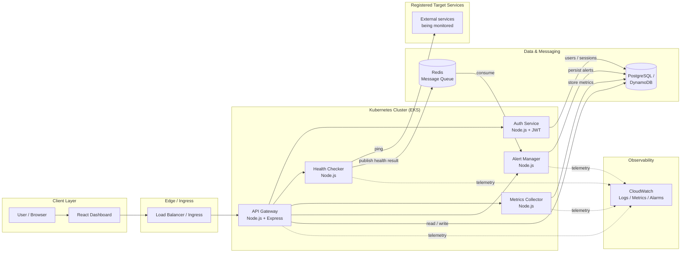
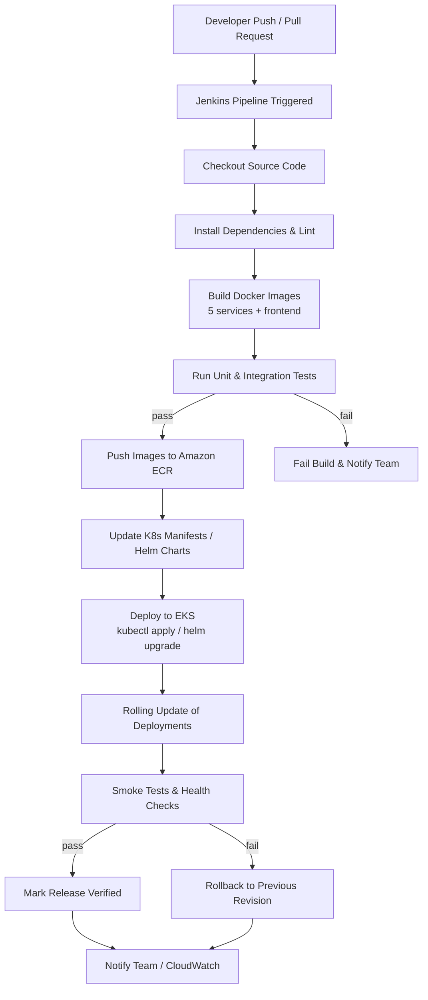
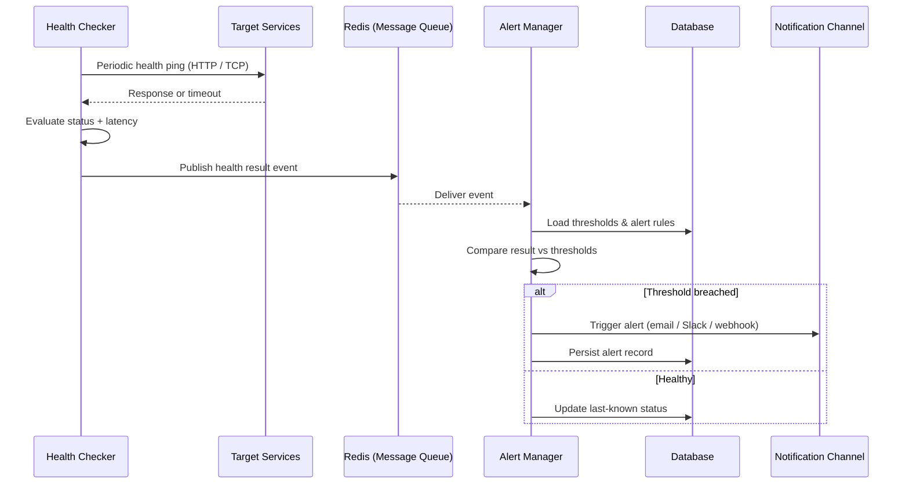
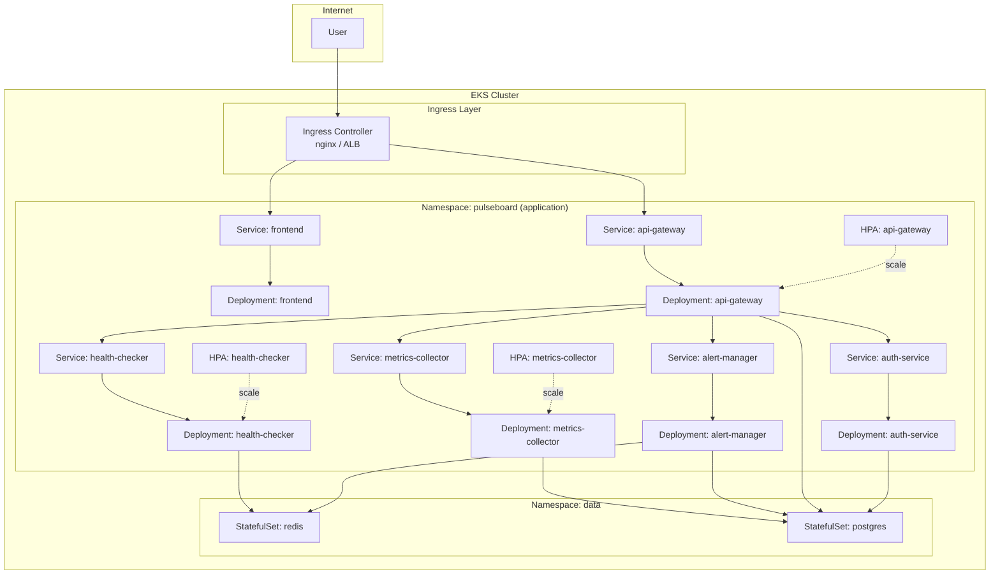
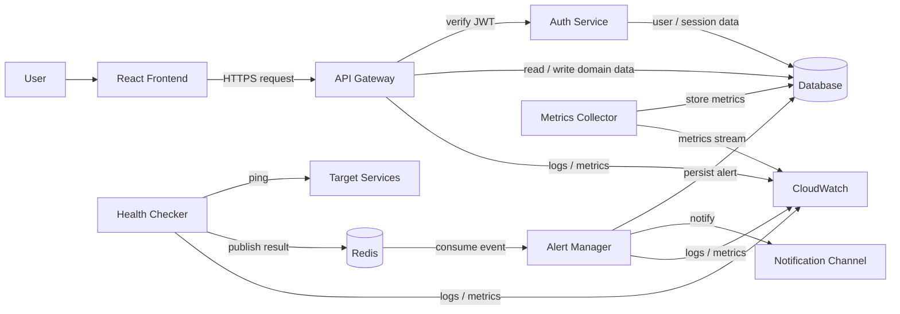
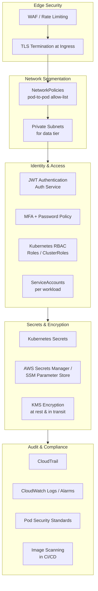

# PulseBoard — Architecture Diagrams

This document collects all architecture diagrams for **PulseBoard**, a real-time infrastructure health monitoring platform. Each diagram is provided as a [Mermaid](https://mermaid.js.org/) diagram (rendered automatically on GitHub/GitLab) plus a short explanation.

**Services covered:**
- API Gateway (Node.js + Express) — routing & auth enforcement
- Auth Service (Node.js + JWT) — user authentication
- Health Checker (Node.js) — periodic service pings, publishes results
- Metrics Collector (Node.js) — CPU, memory, response time
- Alert Manager (Node.js) — consumes health results, triggers alerts
- Frontend (React dashboard)
- Message Queue (Redis)
- Database (PostgreSQL / DynamoDB)
- Observability (CloudWatch)

---

## Table of Contents

1. [System Architecture Diagram](#1-system-architecture-diagram)
2. [CI/CD Pipeline Flow](#2-cicd-pipeline-flow)
3. [Event-Driven Flow](#3-event-driven-flow)
4. [Kubernetes Deployment Architecture](#4-kubernetes-deployment-architecture)
5. [Data Flow Diagram](#5-data-flow-diagram)
6. [Security Architecture](#6-security-architecture)

---

## 1. System Architecture Diagram

High-level view of every PulseBoard component and how they connect at runtime.

**Explanation:** Users interact with the React dashboard, which reaches the cluster through a load balancer / ingress. The API Gateway is the single entry point and delegates to the Auth Service for JWT validation and to the other services for domain work. The Health Checker pings registered target services and publishes results to Redis; the Alert Manager consumes those events and persists alerts. Metrics Collector writes CPU/memory/response-time data to the database. CloudWatch receives telemetry from every service for observability.

---

## 2. CI/CD Pipeline Flow

Jenkins-driven pipeline from commit to verified deployment on EKS.

**Explanation:** Every change triggers Jenkins, which lints, builds container images for all services, and runs tests. On success images are pushed to Amazon ECR and Kubernetes manifests are updated. Jenkins then rolls out the new images to EKS and runs smoke tests; a failure triggers an automatic rollback to the previous revision. Notifications and deployment status are reported to the team and CloudWatch.

---

## 3. Event-Driven Flow

How a health check result travels from the Health Checker to a notification.

**Explanation:** The Health Checker periodically pings each registered target service and evaluates the response. It publishes a health result event to Redis. The Alert Manager consumes the event, loads the configured thresholds and rules from the database, and compares. If a threshold is breached it triggers a notification through the configured channel and stores the alert; otherwise it simply updates the last-known healthy status.

---

## 4. Kubernetes Deployment Architecture

How PulseBoard services are deployed and scaled on Kubernetes.

**Explanation:** An ingress controller exposes the frontend and API Gateway. Each microservice runs as a Deployment fronted by a ClusterIP Service. Horizontal Pod Autoscalers (HPA) scale the API Gateway, Health Checker, and Metrics Collector based on CPU/memory. Redis and PostgreSQL run as StatefulSets in a dedicated data namespace. Services communicate internally via DNS; only the ingress is public.

---

## 5. Data Flow Diagram

End-to-end flow of data from the user through the system and into storage.

**Explanation:** User requests enter through the frontend and API Gateway, which verifies identity via the Auth Service (backed by the database). Domain reads/writes go to the database. In parallel, the Health Checker pings target services and streams results through Redis to the Alert Manager, which persists alerts and notifies. The Metrics Collector stores performance metrics in the database and emits them to CloudWatch; all services also emit logs/metrics to CloudWatch.

---

## 6. Security Architecture

Network policies, RBAC, secrets management, and audit controls.

**Explanation:** Traffic is filtered by a WAF and terminated with TLS at the ingress. NetworkPolicies restrict pod-to-pod traffic to an explicit allow-list, and the data tier sits in private subnets. Identity is enforced via JWT auth with MFA, Kubernetes RBAC, and per-workload ServiceAccounts. Secrets are stored in Kubernetes Secrets backed by AWS Secrets Manager / SSM Parameter Store and encrypted with KMS. Audit and compliance are provided by CloudTrail, CloudWatch, Pod Security Standards, and image scanning in the CI/CD pipeline.

---

*Generated for the PulseBoard project. See `00-diagram-index.md` for the diagram index.*
